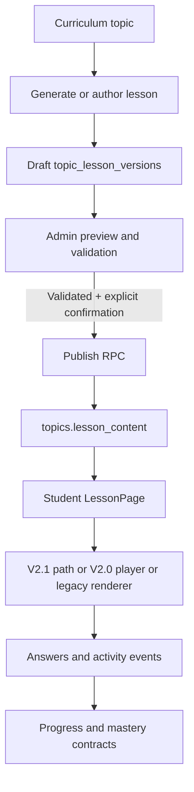

# STUWY F.01 — Existing lesson architecture audit

**Audit date:** 27 November 2026 (Europe/Paris)  
**Reference feature head:** `b2c7c3e87a9930232d03500b2f08fc7f51480f6f`  
**Scope:** Read-only source audit. No runtime, database, branch integration, or production change was made.

## F.03 compatibility implementation update

On the isolated `feature/explanation-v2-interactive-math` implementation line, V2.1 lesson validation now permits the `interactive_activity` block only through the shared `InteractiveActivitySchema` (seven existing kinds). V2.0 normalization now validates the complete normalized payload rather than relying on the former incomplete block type allow-list. `LessonContentStudent → LessonV21Path → LessonV2Player → InteractiveActivityHost` is preserved; no player, runtime registry, schema, or persisted lesson was added. The four-level CM2 fixture uses placeholder test objective IDs and remains local/non-persistent.

This is not integration of the teacher staging workflow. The workflow service, staging page/panel and guarded publication migrations remain on the audited `main` / `feature/guided-practice-lessons` line, absent from the implementation tree. The shared validator's staging prerequisite option is supported, but branch reconciliation and verification that all owning-branch authoring/publication validators delegate to the same activity schema remain required. The separate Supabase Edge Function validator also remains incompatible with interactive blocks; it must not become a direct `topics.lesson_content` write path. No Supabase reads or writes were made.

Final hosted evidence at implementation SHA `a8d5ba301e0f1846edd17f45eb0b5e0fbc3590de`: [run 46074138414](https://github.com/UltraSaura/tutorly-navi/actions/runs/46074138414) passed 195/195 standalone browser checks, 80/80 real LessonV2Player checks (including seven V2.1 activity kinds and the four-level CM2 path at 320/375/390/447/1280px), 6/6 production-built demo checks, 93 unit tests, TypeScript, focused lint, and production build. [QA screenshots/report artifact 15233663871](https://github.com/UltraSaura/tutorly-navi/actions/runs/46074138414/artifacts/15233663871). Vercel READY preview source was the same SHA: [demo route](https://stuwy-6el0v7gsd-stuwy.vercel.app/demo.html). Learning evidence remains local to the current player lifecycle; no durable cross-refresh evidence or mastery/XP calculation change is claimed. Objective binding, teacher approval, the separate Edge Function validator, owning-branch staging workflow reconciliation, and the unavailable canonical architecture/V2.2 references remain open.

## Executive finding

Extend the existing student lesson route and `LessonV2Player` / `LessonV21Path` family; do not add a third player. V2.0 has a typed `interactive_activity` block and host integration. V2.1 has a stronger level-path structure and reuses the V2.0 player per level, but the V2.1 validator rejects `interactive_activity`. Because the student route prefers V2.1 parsing before V2.0 parsing, simply placing the current activity block into V2.1 is invalid. The integration decision is therefore a contract/validation/rendering adapter task, not an engine replacement.

A second boundary is evidence: `ActivityProgress.learningEvidence` distinguishes exposure, guidance, assistance, independence and transfer inside player state. The LessonV2Player emits a completion analytics event with attempts, hints and an `independent` flag, while the existing mastery callback receives only score and threshold. V2.1 level progress persists a score summary to local storage and updates objective mastery; it does not persist the detailed learning evidence. Do not map exposure or assisted completion to independent mastery.

## Source and audit method

Branch heads were read from the fetched remote refs. Paths and contracts below were inspected at those commits; runtime behavior claims are marked where backed by the preceding hosted E.09 evidence, not by a new test run. No Supabase query or write was made. The canonical “Tutorly — Final Product & Adaptive Learning Architecture” reference could not be located in the repository or provided files. No source/document explicitly identifying a V2.2 implementation was found. These are documented gaps, not grounds for reconstructing those architectures.

| Branch | Audited head |
|---|---|
| `main` | `5b5ea1de14c223b28f1838b105b6d82d0385cdf3` |
| `release/v1-stabilization` | `d53af6c49d63fa8bffb9a939e3c5968267c21add` |
| `feature/stuwy-explain-v2` | `cec2b07a802844aacd789bd01e58d8316f73a1c4` |
| `feature/explanation-v2-interactive-math` | `b2c7c3e87a9930232d03500b2f08fc7f51480f6f` |
| `feature/guided-practice-lessons` | `a57846c388c904fff15bc374a13afa06f0d9f6db` |
| `integration/stuwy-explain-v2` | `828413a32af273cb1f2dbc27711f7c86f0574a23` |

`feature/v2-universal-tutor` was explicitly excluded. The branch audit is a source comparison, not a merge or verification that each branch’s UI is deployed.

## Existing lifecycle

### Lifecycle evidence and safeguards

- Student read: `src/components/learning/LessonContentStudent.tsx` queries `topics(name,curriculum_subject_id,lesson_content)`; dispatch order is `parseLessonV21` → `LessonV21Path`, then `parseLessonContent` → `LessonV2Player`, else the legacy lesson renderer. `src/pages/learning/LessonPage.tsx` composes lesson content alongside topic video content.
- Draft generation: `docs/lesson-generation-progress.md` describes explicit topic UUID staging, four sequential levels, per-level and combined validation, then one draft row. It explicitly says staging does not update `topics.lesson_content`. Current staging calls the `generate-lesson-content` Edge Function through `src/services/lessonVersionWorkflow.ts`; this is an internal provider path. No external ChatGPT import-as-draft capability was verified.
- Admin: `src/pages/admin/StagingLessonWorkflowPage.tsx`, `src/components/admin/learning/StagingLessonVersionPanel.tsx`, `src/components/admin/learning/GeneratedLessonsPage.tsx`. Staging generates only after explicit topic selection and duplicate-active-version check; admin can preview, validate a draft, publish a validated row with confirmation. Listing and lesson preview support topic search, country/grade/subject/status filters and read-only content inspection. `topic_lesson_versions` status contract includes `rejected`, but no reject action or lesson-content editing UI was found. The generated-lessons route requires `content.read`; staging route requires `content.write` in `src/App.tsx`.
- Validation/publish: `src/services/lessonVersionWorkflow.ts` validates canonical, pedagogical, prerequisites, geometry and interaction before save/validation. `supabase/migrations/20261014111115_create_topic_lesson_versions.sql` defines a separate JSON draft table with admin RLS and topic FK. `supabase/migrations/20261014111455_publish_topic_lesson_version.sql` requires explicit confirmation, admin role, matching version/topic IDs and `validated` status under row lock; only then it copies content to `topics.lesson_content` and marks the version published. This source audit did not execute the RPC.
- Student progress: `LessonV2Player.tsx` tracks block/answer state in component state; sends interaction analytics; lesson completion upserts `user_learning_progress`. V2.1 `LessonV21Path.tsx` stores level scores and resume positions in learner-scoped local storage and calls `updateMasteryFromTaskResult` for level objectives. The older `useLessonLevelProgress.ts` offers local storage plus a separate `user_learning_progress` count and deduped lesson-completion event. These are distinct progress mechanisms, not interchangeable evidence schemas.

## Engine and rendering comparison

| Engine / workflow | Observed status | Source and evidence | Architectural consequence |
|---|---|---|---|
| Production student renderer | **Integrated and operational** (source integration verified; current production data not inspected) | `src/pages/learning/LessonPage.tsx`; `src/components/learning/LessonContentStudent.tsx` | This is the application entry. Preserve its read and legacy fallback. |
| V2.0 `LessonV2Player` | **Integrated and operational** in student route; hosted fixture checks passed in E.09 | `src/components/learning/LessonV2Player.tsx`; `src/types/lesson-generator.ts`; E.09 CI `#45906620185` | Current interactive activity block is implemented here. State is local while mounted; analytics and lesson completion use existing contracts. |
| V2.1 `LessonV21Path` | **Integrated and operational**, but block compatibility is partial | `src/components/learning/LessonV21Path.tsx`, `src/types/lesson-v21-contract.ts`, V2.1 path gate and storage | Reuses V2.0 player per level. Current contract rejects activity block type. Scores at threshold unlock levels. |
| Canonical `LearningSessionPlayer` | **Not verified / not found** | Searched audited branches and repository; no implementation or contract found | Do not design against an assumed canonical player. Request the missing architecture reference. |
| V2.2 staging | **Not verified as V2.2** | No V2.2 named specification/player found. `topic_lesson_versions` staging workflow exists and is described in `docs/lesson-generation-progress.md` | Refer to it by its implemented “staging lesson version” name; do not relabel it V2.2. |
| Lesson generation contracts | **Integrated, multiple schemas** | `src/types/lesson-generator.ts`, `src/types/lesson-v21-contract.ts`, `src/services/lessonVersionWorkflow.ts`, Edge Function documentation | V2.0 Zod, V2.1 custom validator, legacy fallback and generated staging validation all need to agree. |
| Interactive host | **Implemented and integrated in V2.0** | `src/features/explanation-v2/InteractiveActivityHost.tsx`; `src/components/learning/LessonV2Player.tsx` | Seven kinds share `InteractiveActivitySchema`; no generic arbitrary component lookup should be added. |
| Video | **Integrated as a separate topic content feature** | `src/pages/learning/LessonPage.tsx`, `VideoPlayerBox`, `src/components/learning/InlineVideoPlayer.tsx`, `useVideoPlayer` | Video exists in a sibling topic section, not as a V2.0/V2.1 lesson sequence block. Avoid conflating video completion with lesson mastery. |
| Legacy lesson renderer | **Integrated fallback / legacy** | `LessonContentStudent.tsx` legacy branch after both V2 parsers fail | Preserve existing content readability during schema evolution. |

### Responsibilities and contract mismatch

`LessonV2Schema` in `src/types/lesson-generator.ts` allows `interactive_activity` with `InteractiveActivitySchema`; `LessonV2Player` renders it with `InteractiveActivityHost` and gates progression until its progress is completed. `LessonV21Path` wraps each level lesson in the same player, but `validateLessonV21` in `src/types/lesson-v21-contract.ts` has no activity case and rejects unsupported types. Its “interactive structure detected” admin message must not be read as proof that all V2.1 activity blocks are accepted/rendered.

There is also a fallback edge to review before broad generation: `parseLessonContent`’s normalization path has a `supportedTypes` allow-list that omits `interactive_activity` when the strict parse fails. The strict V2.0 contract works for canonical payloads; optional-field/provider variance can fall through. Add tests for both exact and normalized V2.0 interactive payloads before relying on automated ingestion.

## Lesson structure: schema vs rendered behavior

| Capability | Contract/source evidence | Actual rendering evidence / limit |
|---|---|---|
| Goals, criteria, prerequisites, misconceptions, mastery | V2.0 envelope; V2.1 topic goal, levels, objective IDs and nested lessons | Student player displays prerequisites and blocks; mastery check calls `onMasteryResult`. Admin preview renders goals, criteria and block sequence. |
| Concept, key points, rule, worked/guided example, contrast, reflection | `LessonBlockSchema` and V2.1 validator | `LessonV2Player` has corresponding render branches. Content quality is authored data; schema validity is not pedagogical approval. |
| Visual representations | Shared `VisualSchema`; `PedagogicalVisual`/`LessonVisualBlock` | V2 player/admin can render supported visual kinds. A valid JSON visual can still be inappropriate or inaccessible; teacher review required. |
| Prediction, checkpoints, student try, mastery quiz | Typed blocks with answer types, answers, feedback and hints | Player checks answers, provides retry/gating and analytics. These are not a single independent-assessment guarantee; answer disclosure and hint history must be considered. |
| Interactive demonstration/manipulation | `interactive_activity` with seven validated kinds | V2 host does the manipulation; its block gates “next” on completion. Detailed `learningEvidence` is in player memory. |
| Video | Separate topic video data and player | Rendered on LessonPage outside the lesson sequence. Video end advances a local playlist; it is not proof of understanding. |
| Completion and progress | `user_learning_progress`, interaction analytics, V2.1 level storage/objective updates | UI completion, lesson completion, quiz completion and mastery callbacks are distinct but can be conflated by downstream consumers. No evidence that lesson V2 block position is durable across unmount. |

## Seven-kind compatibility matrix

The seven validated kinds are `fraction-bar`, `fraction-select`, `coordinate-plane`, `algebra-tiles`, `linear-function`, `line-fit`, and `equation-decomposition`. Source is `src/features/explanation-v2/activityContract.ts`; host is `src/features/explanation-v2/InteractiveActivityHost.tsx`.

| Lesson structure / kind | Current compatibility | Requirement before use in generated/published lessons |
|---|---|---|
| V2.0 lesson `interactive_activity` | **Compatible by strict schema and renderer** | Validate activity payload, stable unique block/activity IDs, objective/grade suitability, fallback and evidence boundaries. Test normalized parse fallback. |
| V2.1 level `lesson.sequence[]` | **Incompatible today**: V2.1 validator rejects activity block | Design one explicit backward-compatible contract/rendering adapter; ensure V2.1 validation, admin preview, student player and tests share it. Do not bypass validators with casts. |
| Legacy lesson JSON | **Not compatible** | Keep legacy unchanged. If no valid contract, show existing fallback; never invent identifiers. |
| V2.2 | **Not verified** | Resolve whether a separate accepted spec exists; otherwise no targeting. |

The activity contract’s `schoolLevel` is an allowed label, not proof of curriculum fit. Gate use by an approved grade/objective map; affine-function 3e and line-fit level remain subject to teacher review as recorded in Task E. Unsupported objectives or formats must fall back to existing lesson blocks (concept/visual/worked example/student try) with teacher-authored content, not a fabricated activity kind or component ID.

## Evidence and personalization proposal (design only)

Keep the current mastery calculations unchanged. Add an explicit evidence projection at the player boundary in a later approved implementation:

1. Preserve each activity’s source `learningEvidence` fields as an event payload: exposure, guided completion, assisted success, independent success, transfer, disclosed items, attempts and hints.
2. Add stable lesson-version, level, block, activity, objective and schema-version references to event metadata. An event should be idempotent by attempt/session/event ID, not inferred from the UI success state.
3. Map existing analytics into separate categories: exposure ≠ completion; guided/assisted success ≠ independent; transfer is a separate evidence event; durable mastery remains an existing objective mastery calculation after its existing threshold rules.
4. A projection to the shared student model should be read-only/derived until data owner approves persistence semantics, privacy/retention, idempotency and schema. Do not change `objective_mastery`, `student_mastery`, XP or progression based on a proposed event type in this preparation task.
5. Report missing evidence rather than defaulting it to “independent”. If a lesson player unmounts, current activity progress may be lost; resume requirements must be resolved before promising preservation.

Candidate existing contracts to map, not overwrite: `learning_interaction_events` via `src/services/learningAnalytics.ts`, `user_learning_progress` for lesson completion, and `objective_mastery` through `src/lib/mastery.ts` / `updateMasteryFromTaskResult`. Verify actual schema and ownership during implementation review; this audit did not inspect live data.

## Teacher/admin workflow audit

| Capability | Current evidence | Gap / recommendation |
|---|---|---|
| Draft listing and preview | Staging version list and `GeneratedLessonsPage` preview; existing topic lesson listing | Preserve read-only preview and version identity. Make source version/status conspicuous. |
| Subject, country, grade, status filters | `GeneratedLessonsPage.tsx` selects topic metadata and has search/filter controls | Language is not an explicit filter in the audited UI; verify language contract and show it where supported. |
| Editing | Admin preview is read-only; staging form generates/saves a separate draft | No draft content editing workflow found. Treat as missing, do not rebuild listing/preview. |
| Validation | `validateSavedDraft`; canonical/pedagogical/prerequisite/geometry/interaction checks | Show field-level issues and validator version; human review should be separate from technical validation. |
| Rejection | Database status includes `rejected` | No rejection UI/action found; add only with reason/audit semantics in a later approved task. |
| Publish/version history | Explicit confirm, validated-only RPC, row lock, version table | Protect immutable published versions; ensure a new revision creates a new draft. Current UI lists versions and metadata. |
| Interactive configuration | JSON preview displays block/activity data; runtime host supports V2.0 | No dedicated visual activity editor or V2.1 activity authoring; do not assume one exists. Add schema-aware form only after adapter and teacher workflow decision. |
| External ChatGPT import | Product direction says imported content may be drafts | No verified import workflow found; future intake must parse supported schemas and save as draft only. |

## Recommended target architecture

- Keep topic, version table, generation validation, admin preview, and the established lesson player family as the architecture. The near-term target is **V2.1 level path → existing V2 player**, with a single explicit activity compatibility contract so activities can appear inside accepted level lessons without a second player.
- Keep V2.0 and legacy reads working. Do not mutate already-published JSON in place; create new version rows and publish only through current validated/confirmed path.
- Introduce no runtime module registry yet. Use the existing seven-kind discriminated schema as allow-list; curriculum/objective compatibility should be authored/validated data and teacher-approved mappings.
- Separate technical schema validation, mathematical/content QA, teacher approval and publication. Each is a distinct state or recorded decision; a passing parser is not pedagogical approval.
- Keep video as existing topic content unless a future accepted lesson-block design explicitly needs an in-sequence video; video watch is not an assessment.
- Require support fallback when activity validation fails: retain lesson using existing supported explanation/visual/worked-example/question blocks, or block publication and show issue. Never silently drop an activity or infer a replacement.

## Backward-compatibility requirements

1. Preserve existing V2.0, V2.1 and legacy parsing/rendering; no rewriting published rows.
2. Preserve current stable block IDs, answers, retry/hint rules, completion gates and analytics semantics.
3. Keep V2.1 level unlock thresholds and existing mastery calculation untouched unless separately approved.
4. Unknown activity kind/schema version must fail validation clearly and preserve the content for admin diagnosis; it must not render as a blank or “completed” block.
5. Ensure fallback parser recognizes a supported interactive activity or fails closed with an actionable diagnostic; do not permit unsupported activity IDs.
6. Migrations, if ever needed for evidence, require separate data-owner review and migration plan. No Supabase change is included here.

## Dependencies, risks and unresolved questions

- Missing canonical architecture document “Tutorly — Final Product & Adaptive Learning Architecture”; owner should supply current document/version.
- No verified V2.2 specification/runtime identified. Clarify whether “V2.2 staging” means `topic_lesson_versions` or a separate implementation.
- Confirm which lesson envelope is canonical for new generated/published content; route currently gives V2.1 precedence, but V2.1 disallows the new activity block.
- Decide if progress must survive refresh/unmount at block/answer level; V2.1 stores positions/scores locally, V2.0 activity input is component state.
- Define evidence event ownership, consent/privacy, idempotency and retention before durable events.
- Grade/objective mappings and French terminology need teacher approval; `schoolLevel` is not sufficient.
- Determine if teacher workflow requires draft editing/rejection and external ChatGPT import; current evidence shows no content editor/reject UI/import path.
- No learner/teacher account was used for live production; no Supabase data was read or written.

## F.02–F.08 implementation plan (proposed; not authorized here)

| Phase | Proposed outcome | Acceptance gate / dependencies |
|---|---|---|
| F.02 — Contract decision | Document canonical envelope, block compatibility and unknown-type behavior | Product/architecture owner supplies missing reference; contract tests cover V2.0/V2.1/legacy. |
| F.03 — Compatibility adapter | Allow only approved activity kinds within V2.1 level lesson while reusing LessonV2Player | Shared validator, parser, admin preview and student renderer; exact schema fixture tests; legacy unchanged. |
| F.04 — Authoring/import | Import external ChatGPT lesson JSON as `draft`; optionally add safe editing/reject reason | Admin permissions, explicit topic/version, validation report, no published-content write until publish action. |
| F.05 — Teacher approval | Grade/objective/terminology approval record and review UI using current admin surfaces | Human teacher evaluation; approval remains separate from automated validation. |
| F.06 — Evidence adapter | Project activity evidence to existing analytics/shared model without changing mastery formula | Data-owner/privacy review, idempotency and migration decision; tests for exposure/assisted/independent/transfer separation. |
| F.07 — Resume and progression | Decide durable sequence/activity resume and reconcile V2.1 score/local storage with player progress | Cross-refresh/learner-profile tests and no duplicate XP/completion. |
| F.08 — Release acceptance | Validate generation→draft→review→publish→student player end-to-end | Hosted integration checks, legacy/V2 backward compatibility, teacher-approved content, explicit non-production review before release. |

F.02+ are recommendations only. Teacher approval and authorization for runtime implementation remain separate gates.

## Evidence links and exact source references

- Feature source: [`LessonContentStudent.tsx`](https://github.com/UltraSaura/tutorly-navi/blob/b2c7c3e87a9930232d03500b2f08fc7f51480f6f/src/components/learning/LessonContentStudent.tsx), [`LessonV2Player.tsx`](https://github.com/UltraSaura/tutorly-navi/blob/b2c7c3e87a9930232d03500b2f08fc7f51480f6f/src/components/learning/LessonV2Player.tsx), [`LessonV21Path.tsx`](https://github.com/UltraSaura/tutorly-navi/blob/b2c7c3e87a9930232d03500b2f08fc7f51480f6f/src/components/learning/LessonV21Path.tsx).
- Contracts and host: [`lesson-generator.ts`](https://github.com/UltraSaura/tutorly-navi/blob/b2c7c3e87a9930232d03500b2f08fc7f51480f6f/src/types/lesson-generator.ts), [`lesson-v21-contract.ts`](https://github.com/UltraSaura/tutorly-navi/blob/b2c7c3e87a9930232d03500b2f08fc7f51480f6f/src/types/lesson-v21-contract.ts), [`activityContract.ts`](https://github.com/UltraSaura/tutorly-navi/blob/b2c7c3e87a9930232d03500b2f08fc7f51480f6f/src/features/explanation-v2/activityContract.ts), [`InteractiveActivityHost.tsx`](https://github.com/UltraSaura/tutorly-navi/blob/b2c7c3e87a9930232d03500b2f08fc7f51480f6f/src/features/explanation-v2/InteractiveActivityHost.tsx).
- Admin and publish: [`lessonVersionWorkflow.ts`](https://github.com/UltraSaura/tutorly-navi/blob/5b5ea1de14c223b28f1838b105b6d82d0385cdf3/src/services/lessonVersionWorkflow.ts), [`GeneratedLessonsPage.tsx`](https://github.com/UltraSaura/tutorly-navi/blob/5b5ea1de14c223b28f1838b105b6d82d0385cdf3/src/components/admin/learning/GeneratedLessonsPage.tsx), [`StagingLessonVersionPanel.tsx`](https://github.com/UltraSaura/tutorly-navi/blob/5b5ea1de14c223b28f1838b105b6d82d0385cdf3/src/components/admin/learning/StagingLessonVersionPanel.tsx), [`lesson-generation-progress.md`](lesson-generation-progress.md), migrations `20261014111115_create_topic_lesson_versions.sql` and `20261014111455_publish_topic_lesson_version.sql` on `main` head above.
- Current E.09 evidence inherited from ledger: [hosted run #45906620185](https://github.com/UltraSaura/tutorly-navi/actions/runs/45906620185), [96-file QA artifact](https://github.com/UltraSaura/tutorly-navi/actions/runs/45906620185/artifacts/15156979900). It establishes the interactive fixture/browser checks, not production persistence.
- Preview: [`https://stuwy-mechcwccu-stuwy.vercel.app/demo.html`](https://stuwy-mechcwccu-stuwy.vercel.app/demo.html), Vercel READY deployment source SHA `389c97040c069b6938b3ad77704c7cdc8d3c7d2e`. Compared to final E.09 `b2c7c3e...`, only two documentation files differ; runtime source is identical. The live lab identifies simulated, non-persistent data. It is not the production lesson player.
