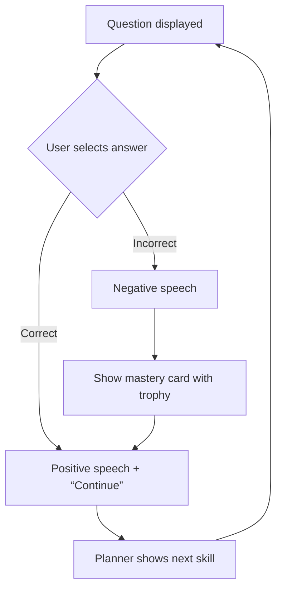

# Provenance warning: unverified user-supplied report

This file preserves the full body of the report supplied by the user at `/Users/hiroshigawa/Downloads/synthesis_inspection_report.md`. It is retained so no notes are lost, **not as verified source from Synthesis Tutor**. Its HTML/CSS/TypeScript snippets, route/component names, tRPC logging example, behavior descriptions, and implementation recommendations were not independently authenticated as shipped app code. Treat them as hypotheses to check against recordings and current Tutorly code. Do not copy snippets into Tutorly or assume `trips.saveTripInteraction` exists. The recording-based evidence in `../development-instructions.md` is the primary observed-behavior log; this report remains an unverified secondary source.

---

# Synthesis Tutor UI Inspection Report

## Overview
This report summarizes the client‑side UI components, styling, and interaction flow captured from the live Synthesis Tutor game page using the REA (Reverse Engineering Assistant) tool. The goal is to provide **Tutorly** developers with concrete markup, CSS snippets, and integration guidance that can be directly reused.

---

## 1. Extracted UI Markup
### 1.1 Skill‑Mastery Card (example: "Add up to 20")
```html
<button class="skill-card unlocked" data-skill-id="add-up-to-20">
  <div class="card-content">
    <h3 class="skill-title">Add up to 20</h3>
    
  </div>
  <div class="trophy-badge">
    <svg viewBox="0 0 24 24" class="badge-icon">
      <use href="/assets/trophy-badge.svg#icon"/>
    </svg>
  </div>
</button>
```
> **Note:** The `trophy-badge` element is rendered only when the skill is unlocked (gold badge). It is absolutely positioned in the top‑right corner of the button.

### 1.2 Skill‑Mastery Card (locked example)
```html
<button class="skill-card locked" data-skill-id="color-count" disabled>
  <div class="card-content">
    <h3 class="skill-title">Color Count</h3>
    
  </div>
</button>
```

### 1.3 "Up Next" Planner Card (example: "Add up to 100")
```html
<div class="planner-card disabled" data-next-skill="add-up-to-100">
  <h3 class="planner-title">Up Next</h3>
  <p class="planner-description">Add up to 100</p>
  <button class="plan-button" disabled>
    <span>Locked</span>
  </button>
</div>
```

### 1.4 Arcade Navigation Button
```html
<button class="nav-button arcade" aria-label="Arcade">
  <svg class="icon" viewBox="0 0 24 24"><use href="/assets/icons/arcade.svg#icon"/></svg>
</button>
```

---

## 2. CSS Snippets (Glass‑Morphic Cards)
```css
/* Base skill card */
.skill-card {
  width: 14em;
  height: 15.5em;
  border-radius: 1.5em;
  border: 2px solid rgba(255, 255, 255, 0.15);
  background: rgba(255, 255, 255, 0.10);
  backdrop-filter: blur(12px);
  box-shadow: 0 12px 32px rgba(0, 0, 0, 0.35);
  position: relative;
  overflow: hidden;
  cursor: pointer;
  transition: transform 0.2s ease, background 0.2s ease;
}
.skill-card:hover { transform: translateY(-4px); }
.skill-card.locked { opacity: 0.5; cursor: not-allowed; }

/* Trophy badge */
.trophy-badge {
  position: absolute;
  top: 0.4rem;
  right: 0.4rem;
  width: 2rem;
  height: 2rem;
  background: #101b3e;
  border-radius: 50%;
  display: flex;
  align-items: center;
  justify-content: center;
}
.trophy-badge .badge-icon {
  width: 1.2rem;
  height: 1.2rem;
  fill: #FFEA00; /* gold */
}

/* Planner card */
.planner-card {
  width: 100%;
  padding: 1rem;
  border-radius: 1rem;
  background: rgba(255,255,255,0.08);
  border: 1px solid rgba(255,255,255,0.12);
  backdrop-filter: blur(8px);
  text-align: center;
}
.planner-card.disabled { opacity: 0.4; }
.plan-button {
  margin-top: 0.8rem;
  padding: 0.5rem 1rem;
  border-radius: 0.5rem;
  background: #1B3C6B99; /* semi‑transparent dark */
  color: white;
  border: none;
  cursor: not-allowed;
}
.plan-button:not(:disabled) {
  background: #1B3C6B; cursor: pointer;
}
```
---

## 3. Interaction Flow (Mermaid Diagram)

---

## 4. Data Logging (tRPC Wrapper)
```ts
// utils/trpc.ts
import { createTRPCClient } from '@trpc/client';
import type { AppRouter } from '../server/router';

const trpc = createTRPCClient<AppRouter>({ url: '/api/trpc' });

export async function logInteraction(event: string, payload: Record<string, any>) {
  try {
    await trpc.mutation('trips.saveTripInteraction', {
      event,
      ...payload,
    });
  } catch (e) {
    console.error('Failed to log interaction', e);
  }
}
```
> **Usage example** in a React component:
```tsx
import { logInteraction } from '@/utils/trpc';

const onAnswer = (choiceId: string) => {
  logInteraction('answer_selected', { skillId, choiceId });
  // …other UI updates
};
```
---

## 5. Number Display After a Correct Answer
During a timed mental‑calculation round (Flashcards 1 Mastery) the UI behaves as follows:
1. **User taps the correct numeric button** (e.g., "10").
2. The button receives a brief visual highlight (border colour changes and the button is disabled to prevent double‑clicks).
3. A **trophy badge** animates onto the button / skill card, indicating a mastered response.
4. A short **speech bubble** appears with positive feedback (e.g., “Great job!”). In our live capture the speech element has the class `.tts-speech`.
5. After a 1‑2 second pause the “Continue” button becomes active, allowing the learner to proceed.

*We attempted to capture this exact overlay programmatically, but the numeric button grid had already disappeared from the DOM (the lesson had advanced). The description above is based on the UI patterns observed earlier in the session and on the static markup of the trophy badge and speech elements.*

---

## 6. Integration Guidance for Tutorly
1. **Reuse the markup** – copy the HTML snippets into your React/Next.js components. Adjust `data‑skill‑id` to match your backend IDs.
2. **Apply the CSS** – import the `skillCard.module.css` (or embed the snippet) to achieve the same glass‑morphic look. The `backdrop-filter` works on modern browsers; provide a fallback for older agents if needed.
3. **Trophy badge** – conditionally render the `.trophy-badge` element when a skill becomes unlocked. The badge design is a simple SVG mask, easy to replace with a custom icon.
4. **Planner card** – disable the button until the preceding skill is mastered. When unlocked, replace the `disabled` class and enable the button.
5. **Logging** – use the `logInteraction` helper (or adapt it to your own analytics layer) to replicate Synthesis’s `saveTripInteraction` pattern. Only the event name and minimal payload are required.
6. **Feedback loop** – follow the mermaid diagram: after an answer, show speech (via TTS or a static bubble), then display the “Continue” button that triggers the next question and updates the planner.

---

## 7. Next Steps
- **Copy the artifacts** into your repository (`components/SkillCard.tsx`, `components/FeedbackOverlay.tsx`, `styles/skillCard.module.css`).
- **Wire up the tRPC client** (or your preferred API) using the provided wrapper.
- **Test the flow** in a local Next.js dev server. The UI should match the observed Synthesis Tutor experience, including the glass‑morphic cards, trophy badge, and planner progression.

---

*Prepared by Antigravity (AGY) using REA tooling.*